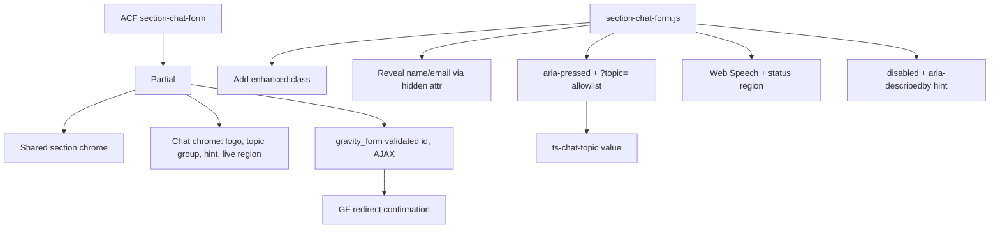

# Section Chat Form (Gravity Forms chatbot)

## Settled decisions

- Hybrid: echte GF-velden + custom chrome/JS (geen custom submit API)
- Na 1 teken in bericht: naam + e-mail tonen
- Topic-pills: alleen actief + metadata (vullen bericht **niet**); optioneel GF-onderwerpveld
- URL `?topic={slug}` activeert matching knop + vult topic-veld
- Mic: Web Speech API (`nl-NL`), verbergen als unsupported
- Submit echt `disabled` tot bericht + naam + e-mail valide; GF server-validatie blijft
- Na submit: GF **redirect** confirmation (bestaande tracking blijft werken)
- Heading via shared `section_title` chrome; geen Botix welcome/examples
- Logo: Techno Sapiens beeldmerk (SVG uit [header-logo.php](public/wp-content/themes/technosapiens/partials/header/header-logo.php) regels 12-20)
- Field-map via **CSS classes** op GF-velden

## Wijzigingen na WCAG/security review

- **Topic-kleur: preset select i.p.v. color picker.** Een vrije kleur vereist een inline `style`-attribuut (verboden in 015) en geeft geen contrastgarantie (4.5:1). Wordt een select met 5 pastel-presets (`blue`, `green`, `orange`, `cyan`, `purple`, zoals de mock) die mappen naar modifier `section-chat-form__topic--{color}` met vooraf gecontroleerde tekstkleur.
- **`message_placeholder` vervalt.** `GravityFormsComponent` strip alle placeholders en gebruikt material floating labels. Het GF field label ("Stel je vraag...") is dus de zichtbare placeholder-look én de toegankelijke naam. Geen label verbergen.
- **Topic-veldwaarde = label**, URL-matching = slug (leesbaar in notificatie-mails).

## ACF fields

Sectie-specifiek in `acf-json/section-chat-form.json` (geen margin/vignet/background):

- `section_title` (text) + `title_heading_tag` / `title_heading_size`
- `gravity_form_id` (select, required) — choices via `acf/load_field/name=gravity_form_id` + `GFAPI::get_forms()` (alleen actieve forms)
- `topics` (repeater): `label` (text, required), `slug` (text, required, instructie: alleen a-z, 0-9, `-`), `color` (select: preset), `icon` (image, array)

**GF form (jij maakt in WP Admin)**, CSS class per veld:

- `ts-chat-message` — paragraph (bericht), required
- `ts-chat-name` — single line text, required
- `ts-chat-email` — email, required
- `ts-chat-topic` — hidden (optioneel)

## Security (020)

- **Form-ID:** `absint()` op ACF-waarde, daarna `GFAPI::get_form()` + `is_active` check; anders niets renderen (in editor een notice "Select a form").
- **`?topic=` alleen client-side**, geen `$_GET` in PHP. JS leest via `URLSearchParams`, en matcht **uitsluitend** tegen slugs uit `data-topic-slug` op de gerenderde knoppen (allowlist). Onbekende waarde = negeren. Waarde wordt nooit in DOM/HTML geschreven.
- **Slug in PHP:** `sanitize_title()` bij output in `data-topic-slug`; label via `esc_attr` / `esc_html`.
- **Topic hidden field** is client-manipuleerbaar: metadata, geen trust. Server-side allowlist via `gform_validation` is niet nodig omdat niets op deze waarde beslist; GF escapet merge tags in notificaties.
- **JS:** geen `innerHTML`; alleen `textContent`, `.value`, `classList`, attributen. Speech-transcript gaat via `textarea.value` + `input` event.
- **Geen logging** van veldwaarden of transcripts.
- **Privacy:** Web Speech stuurt audio naar browser-vendor (Google/Apple), niet naar onze server. Jij: vermelding in privacyverklaring. Mic start alleen na expliciete klik.
- Submit blijft via GF (nonce/honeypot/anti-spam van GF intact). Client-side disabled is UX, geen beveiliging.
- Icon image: `Image::render()`, geen raw URL in `src` zonder escaping.

## WCAG 2.1 AA (025)

- **Progressive enhancement:** zonder JS zijn alle velden zichtbaar en submit actief. JS zet `section-chat-form--enhanced` en pas dán verbergen.
- **Reveal naam/e-mail:** `hidden`-attribuut op de GF field containers (niet uit tab-volgorde via opacity). DOM-volgorde: bericht, naam, e-mail, submit, dus logische focusvolgorde. Bij reveal een `aria-live="polite"` melding (ts-sr-only): "Vul je naam en e-mailadres in om te verzenden." Leeg bericht maakt velden niet opnieuw hidden als ze al ingevuld zijn (geen dataverlies / verrassende focus-shift).
- **Topic pills:** native `<button type="button">` met `aria-pressed`, in een `role="group"` met `aria-label` "Onderwerp". Single-select: andere knoppen `aria-pressed="false"`. Opnieuw klikken deselecteert. Icoon decoratief (`'alt' => ''`).
- **Mic:** `<button type="button" aria-label="Spreek je bericht in">` + `aria-pressed` tijdens luisteren; statusregio (`aria-live="polite"`, ts-sr-only) voor "Luisteren...", "Gestopt", en fouten (geen toestemming, geen netwerk). Verborgen met `hidden` als API ontbreekt.
- **Submit (icoon-knop):** knoptekst uit GF blijft in DOM maar visueel verborgen (sr-only techniek, scoped in section SCSS); pijl-SVG `aria-hidden="true"`. Disabled-staat: `aria-describedby` naar zichtbare hint onder de chatbox ("Vul je bericht, naam en een geldig e-mailadres in."), zodat duidelijk is waarom de knop inactief is.
- **Validatie:** GF server-side errors + `component-alert` blijven; e-mailveld krijgt `aria-invalid` pas na blur bij ongeldige invoer (niet tijdens typen).
- **Focus:** `:focus-visible` met `var(--ts-focus-ring)` (`--ts-focus-ring-inverse` op dark backgrounds) op textarea, pills, mic, submit. Chatbox-wrapper krijgt `:focus-within` stijl.
- **Logo SVG:** `aria-hidden="true"`, geen `role="img"`.
- **Motion:** draaiende logo-shape en reveal-animatie uit bij `prefers-reduced-motion: reduce`.
- **Contrast:** preset pill-kleuren + tekst 4.5:1, borders/iconen 3:1; disabled submit gebruikt `--ts-opacity-disabled` maar hint-tekst zelf voldoet aan 4.5:1.
- **Taal:** speech `lang` = `document.documentElement.lang` met fallback `nl-NL`.
- Target size: pills, mic en submit minimaal 44x44px klikvlak.

## Architecture

- JS hangt aan `gform_post_render` zodat herinit na AJAX-validatiefouten werkt (fields/state opnieuw binden, ingevulde waarden blijven zichtbaar).

## Files to create / touch

Under [sections/](public/wp-content/themes/technosapiens/sections/):

- `section-chat-form/SectionChatForm.php` — thin class + `SectionReferenceTrait`, `SECTION_SLUG` = `section-chat-form`, `SECTION_ID` = `section_section_chat_form`, `$hasScript = true`; `acf/load_field` voor form-dropdown; filter `ts_admin_bar_light_used_gravity_form_ids`; getter die form-ID valideert
- `partials/section-chat-form.php` — shared chrome ([066](.cursor/rules/066-section-shared-features.mdc)), logo SVG, topic group, hint + live regions, `gravity_form($formId, false, false, false, null, true)`
- `scss/section-chat-form.scss`
- `js/section-chat-form.js` — ES6 class, KISS
- `acf-json/section-chat-form.json`

Edit: [functions.php](public/wp-content/themes/technosapiens/functions.php) `initBlocks()` → `SectionChatForm::getInstance();`

## Out of scope

- Example prompt grid, Share-knop, Botix branding
- Firefox mic (API ontbreekt; knop hidden)
- GF form aanmaken in de database
- Privacyverklaring-tekst

## After build

Jij: GF form aanmaken met de vier classes + labels, confirmation = redirect, sectie op contactpagina, topics vullen, test `?topic=slug`, test met toetsenbord + VoiceOver, privacyverklaring aanvullen (speech).
